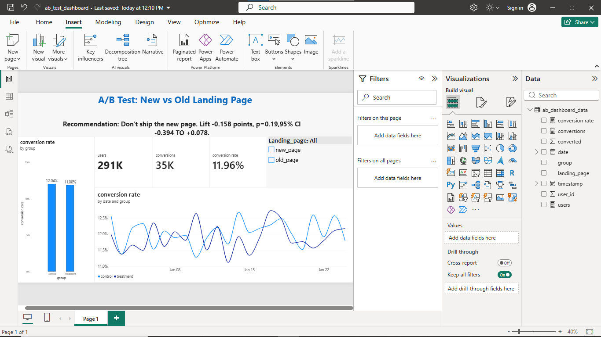

# A/B Test Analysis: New vs Old Landing Page

## Business question
Does the new landing page convert more visitors than the old one, and should we ship it?

## Data
Kaggle A/B Testing dataset (`ab_data.csv`): about 294,000 user sessions with group (control/treatment), landing page (old/new), and a converted flag (0/1).

## Tools
Python (pandas, statsmodels, scipy, matplotlib), SQL (SQLite), Power BI

## Method
1. **Cleaning:** removed 3,893 rows where group and page did not match and 1 duplicate user. Final dataset: 290,584 users.
2. **Randomization check:** groups were 50.006% treatment and 49.994% control, so there was no sample ratio mismatch.
3. **Hypotheses:** H0: conversion rates are equal. H1: they are different. Significance level 0.05.
4. **Tests:** two-proportion z-test, 95% confidence interval for the difference, chi-square cross-check, bootstrap confidence interval (10,000 resamples), and power analysis.
5. **SQL:** recreated the group conversion rates, converted vs not converted by page, and the daily trend with GROUP BY, CASE WHEN, and a CTE.
6. **Dashboard:** Power BI page with KPI cards, conversion rate by group, daily trend, and the recommendation.

## Results
| Group | Users | Conversions | Conversion rate |
|---|---|---|---|
| Control (old page) | 145,274 | 17,489 | 12.039% |
| Treatment (new page) | 145,310 | 17,264 | 11.881% |

- Difference (treatment minus control): **-0.158 percentage points**
- p-value: **0.1899**
- 95% CI for the difference: **-0.394 to +0.078 points** (includes zero)
- Bootstrap 95% CI: **-0.388 to +0.075 points**
- Users needed per group to detect a 1-point lift: 17,208 (we had about 145,000)

## Recommendation
**Do not ship the new page.** The new page did slightly worse than the old one, and the difference is not statistically significant. The confidence interval includes zero, and even its best case (+0.078 points) is far below the 1-point lift worth shipping. The test had enough users to detect a 1-point lift, so this is a real "no evidence of improvement" result, not a lack of data. Keep the old page and test a different design change.

## Limitations
- Only conversion rate was measured (no revenue or bounce rate).
- No segment data such as country or device.
- Results cover only the test period.

## Files
- `ab_test_analysis.ipynb`: Python analysis
- `ab_test_queries.sql`: SQL queries
- `dashboard.png`: dashboard screenshot
- `ab_test_dashboard.pbix`: Power BI file

## Dashboard

